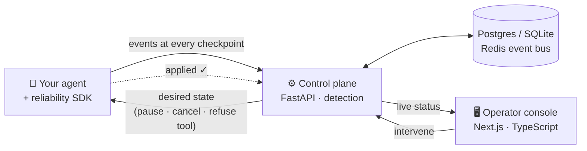

<div align="center">

<picture>
  <source media="(prefers-color-scheme: dark)" srcset="https://capsule-render.vercel.app/api?type=waving&height=200&color=0:0d1117,50:0b3d4f,100:00f6ff&text=Samagra%20Gune&fontSize=48&fontColor=ffffff&animation=fadeIn&fontAlignY=36&desc=I%20build%20AI%20agents%20%E2%80%94%20and%20the%20systems%20that%20keep%20them%20honest&descAlignY=58&descSize=17">
  <source media="(prefers-color-scheme: light)" srcset="https://capsule-render.vercel.app/api?type=waving&height=200&color=0:e0fbff,50:6ee7f9,100:0b3d4f&text=Samagra%20Gune&fontSize=48&fontColor=0d1117&animation=fadeIn&fontAlignY=36&desc=I%20build%20AI%20agents%20%E2%80%94%20and%20the%20systems%20that%20keep%20them%20honest&descAlignY=58&descSize=17">
  
</picture>

<a href="https://github.com/samagragune">
  
</a>

<br/><br/>

[](https://www.linkedin.com/in/samagragune/)
[](https://x.com/gunesamagra)
[](https://github.com/samagragune?tab=followers)
[](https://github.com/samagragune?tab=repositories)


</div>

---

## ⚡ About me

```python
class Samagra:
    role       = "Software developer"
    builds     = ["AI agents", "agent infrastructure", "developer tools"]
    shipping   = "klaw — a control plane that can actually pause a running AI agent"
    stack      = {"backend": ["Python", "FastAPI", "SQLAlchemy"],
                  "frontend": ["TypeScript", "Next.js", "Tailwind"],
                  "ai": ["Gemini", "Claude", "Qwen2.5-VL", "SAM 2"]}
    principle  = "Never let the UI claim success before the system confirms it."
```

> [!TIP]
> Interested in agent reliability, LLM tooling or robotics? My DMs on [X](https://x.com/gunesamagra) and [LinkedIn](https://www.linkedin.com/in/samagragune/) are open.

---

## 🚀 What I'm building

### 🛡️ [klaw](https://github.com/samagragune/klaw) &nbsp;·&nbsp; the control plane for autonomous AI agents

[](https://github.com/samagragune/klaw/commits)
[](https://github.com/samagragune/klaw)
[](https://github.com/samagragune/klaw/stargazers)


Most "agent observability" tools stream traces and stop there. **Watching an agent doesn't let you stop it.** klaw's SDK runs *inside* the agent's own coroutine and yields to the control plane at checkpoints: before every tool call, before every model call, and wherever you ask. Pause, resume, cancel and tool refusal are applied for real, and the dashboard only reports success after the runtime confirms it.



<details>
<summary><b>Integrating it is about ten lines</b></summary>

```python
from reliability import Supervisor

supervisor = Supervisor(agent_id="research-agent")

@supervisor.monitor(task="Research AI startups")
async def research():
    async with supervisor.tool("search", {"q": "AI startups"}) as call:
        call.set_result(await my_search("AI startups"))
    async with supervisor.llm("gpt-4o-mini") as call:
        response = await my_model_call()
        call.record_usage(response.prompt_tokens, response.completion_tokens)
```

Privacy by default: arguments and completions stay in your process. Only a locally computed SHA-256 fingerprint is sent, which is enough for the backend to detect identical repeated calls (loops).
</details>

<br/>

### 🔎 [Fynder](https://github.com/samagragune/Fynder-) &nbsp;·&nbsp; deep research, in your terminal

[](https://github.com/samagragune/Fynder-/commits)
[](https://github.com/samagragune/Fynder-)
[](https://github.com/samagragune/Fynder-/blob/main/LICENSE)


A terminal-native AI research agent. Ask a question in plain language and it plans, calls tools (live web search, arXiv, Wikipedia, page scraping, CSV analysis) and returns a **cited** answer. Every tool call is visible step by step with `--verbose`, and you can add your own tool in about five lines with a `@tool` decorator.

<br/>

### 🦾 [Cognitive Autonomy Layer for Robotic Arms](https://github.com/samagragune/Project_Exhibition-Team155-) &nbsp;·&nbsp; v3.0

[](https://github.com/samagragune/Project_Exhibition-Team155-/commits)
[](https://github.com/samagragune/Project_Exhibition-Team155-)


This replaces hard-coded state machines and brittle end-to-end VLA models with **hierarchical multimodal reasoning** for low-cost robotic arms. It fuses SAM 2.1 segmentation with a metric depth sensor to get millimetre-accurate 3D grasp points, and the reasoning runs on Qwen2.5-VL, DeepSeek-VL2, Gemini or local models. It ships four simulated worlds (workspace sorting, Mars-rover sample curation, a chemistry lab and electronics QA) and a live web cockpit.

---

## 🛠️ Tech stack

<div align="center">

<picture>
  <source media="(prefers-color-scheme: light)" srcset="https://skillicons.dev/icons?i=py,ts,js,nodejs,fastapi,nextjs,react,tailwind&theme=light&perline=8">
  
</picture>
<br/>
<picture>
  <source media="(prefers-color-scheme: light)" srcset="https://skillicons.dev/icons?i=postgres,redis,sqlite,docker,pytorch,linux,git,vscode&theme=light&perline=8">
  
</picture>

<br/><br/>

**AI and models**


</div>

---

## 🧭 How I like to build

| | |
|---|---|
| 🔍 **Show the work** | Agents should expose every tool call, argument and result. Fynder's `--verbose` and klaw's traces exist for this. |
| ✅ **Confirm, don't assume** | A command is `pending → acknowledged → applied`. Nothing claims success early. |
| 🔒 **Private by default** | Send fingerprints, not payloads, unless the user opts in. |
| 🚢 **Ship, then sharpen** | Get it running end to end first, then make it better. |

---

<div align="center">

<sub>Thanks for stopping by. Always up for interesting conversations and collabs. 🚀</sub>


</div>
